# 淘宝深夜浏览：是冲动消费还是闲逛？

> **一句话结论**：首次浏览发生在深夜（22–01 时）或凌晨（02–05 时）时，随后 1 小时和 24 小时内的购买率都**显著低于**白天（09–17 时）。数据**不支持**「深夜更容易冲动下单」，**支持**「深夜浏览更像闲逛」——晚上看了、最后大多不买。

本仓库是 IS5312（Analytical Programming with Python）课程项目，用[天池 649「淘宝 UserBehavior」](https://tianchi.aliyun.com/dataset/649)公开数据，完整走一遍「**数据清洗 → 建模 → 可视化**」，回答一个反直觉的电商问题：**深夜流量到底值不值得买？**

---

## 目录

1. [结论速览](#结论速览)
2. [要回答什么问题](#要回答什么问题)
3. [数据](#数据)
4. [方法总览](#方法总览)
5. [结果（含图）](#结果含图)
6. [商业含义](#商业含义)
7. [局限](#局限)
8. [验证与可复现](#验证与可复现)
9. [如何运行](#如何运行)
10. [仓库结构](#仓库结构)

---

## 结论速览

| 方法 | 关键结果 |
|---|---|
| 固定效应 LPM（M2） | 深夜 vs 白天 Y1 **−0.179 pp**、Y2 **−0.307 pp**；凌晨 Y1 −0.238 pp、Y2 −0.230 pp（Holm p < 1e-15） |
| 生存分析（Cox） | 深夜 HR **0.705**（→「不买」，1–24h HR 0.635）；凌晨 HR 0.743（→「晚买」，1–24h HR 0.975） |
| Causal Forest | ATE **−0.181 pp**（与 FE 一致）；BLP β 1.26；GATES Q5−Q1 +0.39 pp；99.9% 的 CATE 为负 |
| 阶段二 A（按小时） | 上午 09–11 点最能买；**23 点 24h 转化全天最低**；00–02 点是「隔夜转化」 |
| 阶段二 B（冷/热门） | 深夜损失冷门最大（−0.44 → −0.08 pp）；相对损失 −38% → −19% |
| 品类扩展 | 21 个品类深夜 24h HR 全部 <1（0.58–0.81） |

三种独立方法（固定效应、生存分析、Causal Forest）给出**同一个方向**的答案，且互相印证。

---

## 要回答什么问题

电商常识认为「深夜更容易冲动下单」。但反过来的可能是：**深夜浏览大多是消磨时间的闲逛，看了不买**。

所以核心问题是：**用户第一次点开一个商品发生在深夜，和发生在白天相比，之后买不买、多久买？**

商业上这直接对应：按时段出价/推送时，深夜流量该加价还是降权？

---

## 数据

- **来源**：[天池 649「淘宝 UserBehavior」](https://tianchi.aliyun.com/dataset/649)，共 **100,150,807 条原始事件**（清洗后 100,095,182 条），上海时区 2017-11-25 至 12-03（9 天）。
- **字段**：只有 `user_id / item_id / category_id / behavior(pv·fav·cart·buy) / timestamp`，**没有价格、停留时长、心理标签**。
- **分析单位**：不是 1 亿条独立样本，而是「用户—商品」的**首次可见浏览 episode**：`t0` = 该用户第一次浏览该商品的时刻。共 **51,316,512 个 episode、983,132 名用户**。
- **结果变量**：`Y1` = 1 小时内购买（基线 0.65%）、`Y2` = 24 小时内购买（0.98%）。
- **时段分箱**（按 t0 的本地小时）：白天 09–17（参照）、晚间 18–21、**深夜 22–01**、凌晨 02–05、早晨 06–08。

下面这张图展示了「1 亿行原始操作 → 5,131 万条 episode」是怎么压出来的：

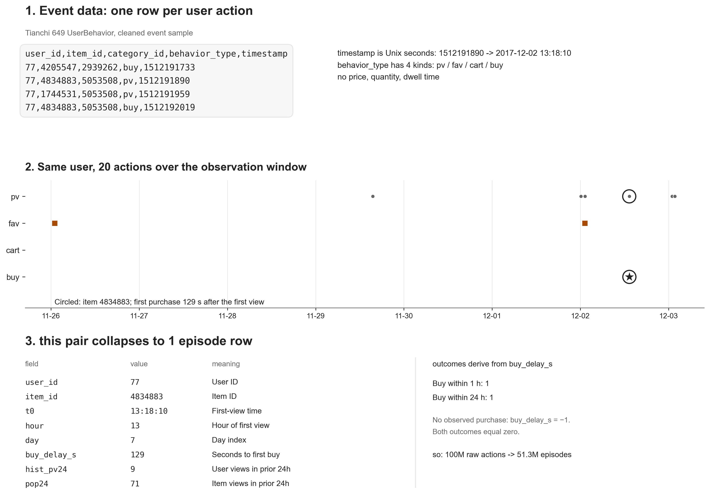

> 注：约 40% 的购买在 9 天窗口内没有任何前置浏览/收藏/加购记录，进不了 episode，所以结论只覆盖「**先浏览、后购买**」这条路径。

商品是高度长尾的（9,439 个匿名品类），前 12 个品类只占少部分事件：

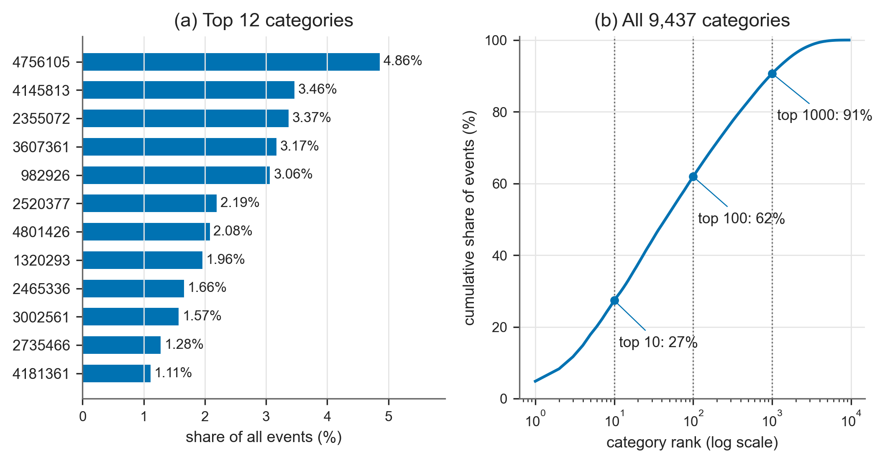

---

## 方法总览

项目用**三种互补的方法**，从不同角度回答同一个问题，再互相印证。

### ① 固定效应线性概率模型（FE-LPM）

把「谁在逛、逛哪个商品、哪一天」这些**不随时间变化的混淆因素全部吸收掉**，只留下「**同一个人、同一个商品、同一天里，深夜 vs 白天**」的条件关联。

- 主模型 **M2**：用户 FE + 商品 FE + 日期 FE + 3 个处理前控制变量。
- 用线性概率模型而非 logit，是因为三层高维固定效应可以**精确吸收**（`pyhdfe`）。
- 标准误按 **user × item 双向聚类**；4 个主检验做 **Holm 校正**；7 项预设稳健性（S1–S7）。
- 模型序列 M0（无 FE）→ M1（+用户 FE）→ M2（+商品+日期 FE），看系数如何收缩，判断混淆来自哪。

### ② 生存分析（Cox）

不只问「买不买」，还问「**多久买**」，从而区分「不买」和「晚买」。

- 事件 = 24 小时内首次购买；24h 后才买视作删失。
- 用自写的 `fastcox.py`（Breslow 结点、用户聚类 Lin-Wei 标准误），因为它能跑 3,077 万行，而 statsmodels/lifelines 做不到（已验证结果一致）。
- 分段 Cox：`[0,1h)` 与 `[1h,24h)`，看深夜没买的人之后会不会追回来。

### ③ Causal Forest（CausalForestDML）

问「深夜效应在**谁身上更强**」（异质性）。

- 样本只保留深夜（T=1）或白天（T=0）的 episode；结果 Y1×100（pp）。
- 1,000 棵树、honest 分裂、按用户分组交叉拟合；干扰模型用 LightGBM（验证集早停）。
- 测试集评估：样本外 DML ATE、BLP、GATES 五分位、CLAN，全部按用户聚类。

### ④ 阶段二 + 品类扩展（深化）

- **子分析 A**：把一天按小时分组（24 组，参照 14 时）× 三个购买窗口（1h/3h/24h），找出哪些小时「当场买」「晚点买」「干脆不买」。
- **子分析 B**：冷门 vs 热门商品的深夜损失。
- **品类扩展**：分品类重跑生存分析 + 带品类特征的 Causal Forest。

---

## 结果（含图）

### 5.1 固定效应：深夜和凌晨都比白天买得少

M2 主模型（940 万 episode），系数单位是百分点（pp），参照白天 09–17：

| 对比 | Y1 即时购买（95% CI） | Y2 24 小时购买（95% CI） |
|---|---|---|
| 深夜 22–01 vs 白天 | **−0.179**（−0.198, −0.160） | **−0.307**（−0.330, −0.284） |
| 凌晨 02–05 vs 白天 | **−0.238**（−0.282, −0.194） | **−0.230**（−0.285, −0.175） |

白天参照组均值 Y1=0.75%、Y2=1.12%，所以深夜相对低约 24%–27%，凌晨低约 20%–32%。

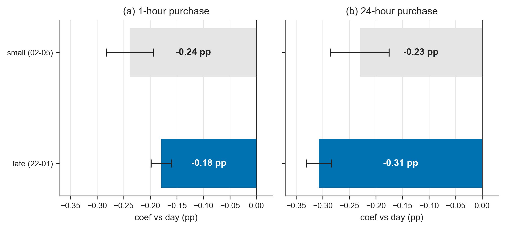

**「谁在深夜逛」只解释一小部分。** 逐层加固定效应看深夜 Y1 系数的变化：

- M0（无 FE）−0.215 pp → M1（+用户 FE）−0.229 pp（几乎不变）→ M2（+商品+日期 FE+控制）**−0.179 pp**。

也就是说，深夜逛的人本身并不「天然不爱买」；真正压缩差异的是商品构成、日期和控制变量。

**7 项预设稳健性全部保持负号、CI 不含 0**（去控制变量、加会话强度、10 分钟窗口、换聚类、72h 洗出、剔重度用户、复现样本）：

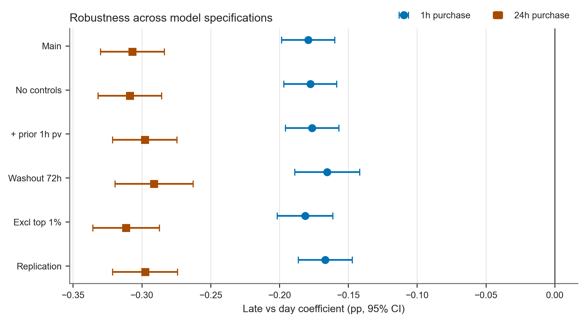

**小时形状**（M2，参照 14 时）：Y1 最低在 02 时（−0.28 pp），Y2 最低在 23 时（−0.37 pp），10 时最高。白天整体居高、夜间偏低，但不是对称 U 形：

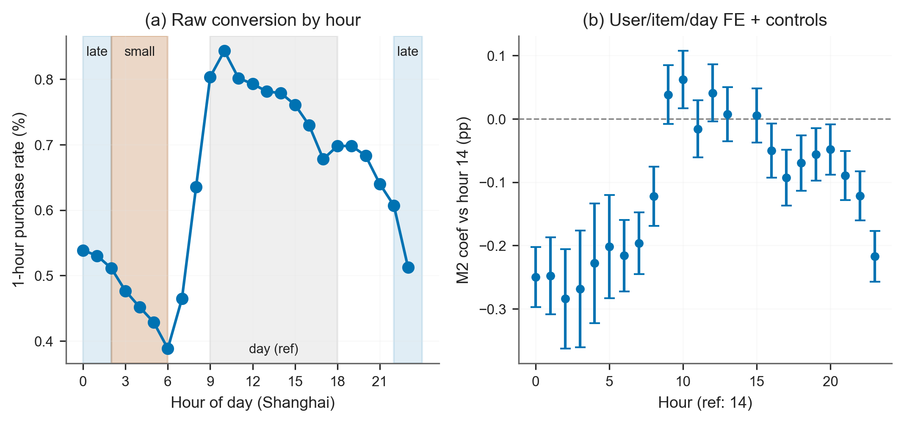

### 5.2 生存分析：深夜是「不买」，凌晨是「晚买」

Cox 风险比（HR，训练集 3,077 万 episode）：

| 模型 | 深夜 HR（95% CI） | 凌晨 HR（95% CI） |
|---|---|---|
| M2（+控制+日期） | **0.705**（0.696, 0.715） | **0.743**（0.719, 0.768） |
| 分段 0–1h | 0.741（0.728, 0.754） | 0.627（0.599, 0.655） |
| 分段 1–24h | **0.635**（0.621, 0.649） | **0.975**（0.932, 1.021） |

- **深夜**：两段 HR 都显著 <1，1 小时后的 HR 反而**更低** → 不只是「晚点买」，而是「买得更少」。
- **凌晨**：0–1h 显著低，1–24h 的 CI 包含 1 → 主要是「**推迟购买**」。

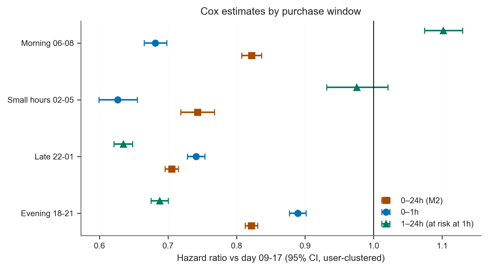

测试集累计购买曲线（24h 累计：白天 1.16%、深夜 0.80%、凌晨 0.85%）。深夜曲线在 1–6h 几乎平坦（用户在睡觉），之后也**一直没有追平**白天；凌晨曲线在 6–24h 追赶：

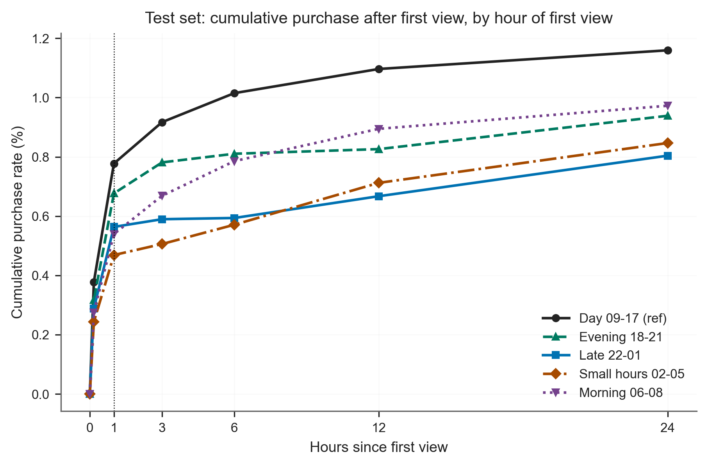

> 预测力：M2 的 C-index 仅 0.624（只放时段的 M1 为 0.538）——时段只解释购买时间的一小部分，本分析目的是**比较时段**，不是做预测。

### 5.3 Causal Forest：异质性真实存在，但主要是「规模效应」

测试集（649 万 episode）结果：

| 指标 | 估计（95% CI） |
|---|---|
| 样本外 DML ATE（深夜 vs 白天，Y1） | **−0.181**（−0.199, −0.163），与 FE 的 −0.179 几乎相同 |
| BLP 异质性系数 β | **1.26**（1.05, 1.47），显著 >0 → 异质性不是噪声 |
| GATES Q5 − Q1 | **+0.39**（0.33, 0.45） |
| 预测 CATE 为负的比例 | 99.9% |

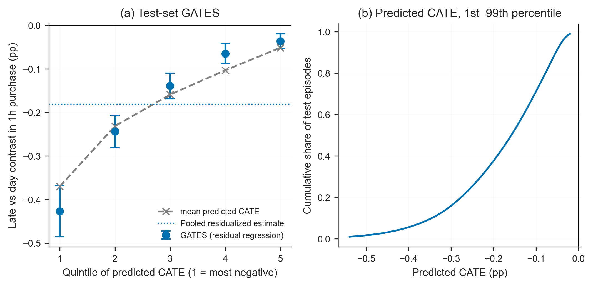

解读：异质性真实存在，但**主要是规模效应**——在本来就容易购买的场景（冷门长尾商品、已经买过东西的用户）里，深夜损失的绝对百分点最大。按相对幅度看，各组都比白天低约 17%–26%，**不存在「某类人深夜反而更爱买」的子群**。森林最依赖的特征是「商品过去 24h 浏览热度」（重要性 0.54）。

### 5.4 阶段二 A：一天 24 小时，哪些小时「当场买 / 晚点买 / 不买」

按小时 × 三个窗口（1h / 3h / 24h）跑 Cox（参照 14 时）：

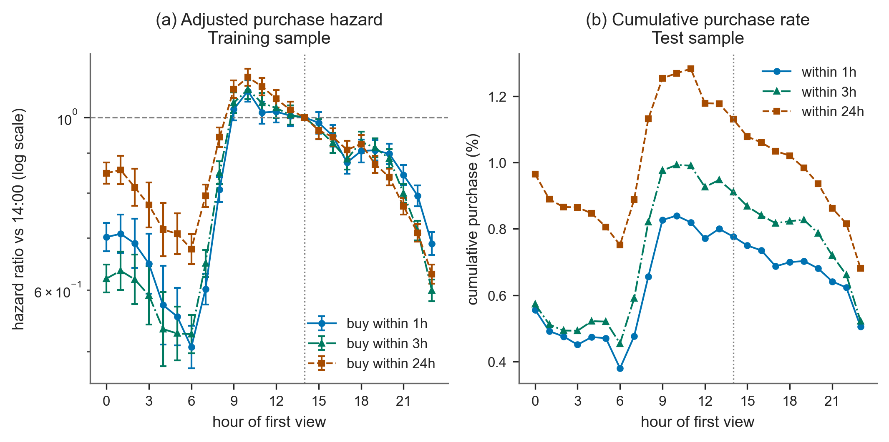

- **上午 09–11 点最能买**：10 点三个窗口 HR 1.08 / 1.09 / 1.13，24h 累计 1.269% 全天最高。
- **21–23 点是「不买」**：23 点 24h HR 0.629、24h 累计 0.681%，都是全天最低。
- **00–02 点是「隔夜转化」**：1h HR 只有 0.69–0.71，24h 回到 0.81–0.86，典型的「看完睡觉、醒了再买」。
- **凌晨 04–07 点即时购买最低**（06 点 1h HR 0.51），24h 有回升但水平仍偏低。

### 5.5 阶段二 B：冷门 vs 热门商品的深夜损失

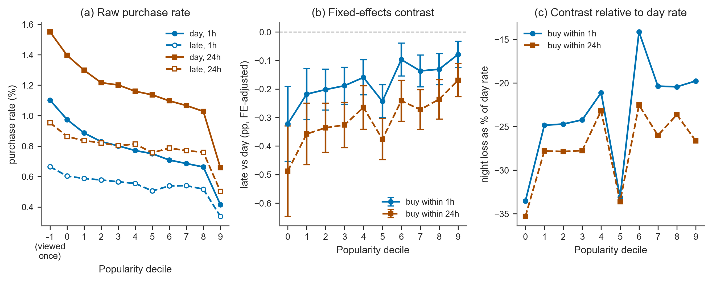

- 白天转化率随热度单调下降：Y1 从最冷档 **1.10%** 降到最热档 **0.42%**（冷门「看了就买」，热门「围观多、买得少」）。
- 深夜绝对损失随热度缩小：**−0.44 pp → −0.08 pp**。
- 相对损失比绝对损失平坦得多，但不完全一样：最冷 −38%~−40%，最热 −19%~−24%。**「主要是规模效应，但长尾冷门商品相对上也更怕深夜」**。

### 5.6 品类扩展：21 个品类的深夜损失

对前 20 大品类 + 「其他」分别重跑生存分析，21 组深夜 24h HR **全部 <1**（0.58–0.81），说明「深夜买得少」不是某几个品类的特例，而是普遍现象：

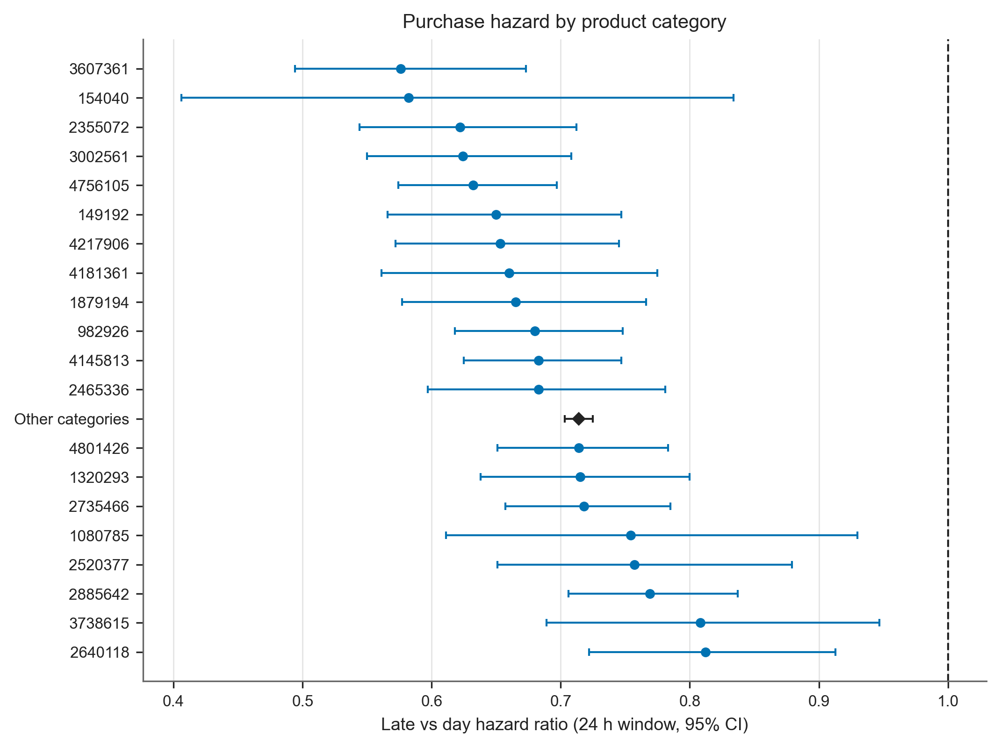

带品类特征的 Causal Forest 测试集 ATE 仍是 −0.181 pp，且品类特征的总重要性 ≈ 0（6.5e-5）——品类本身不改变结论。

---

## 商业含义

1. **深夜流量即时与次日转化都更低**，按时段出价/推送时可下调深夜权重；其中 **21–23 点是最该降的一段**。
2. **凌晨流量是「推迟转化」**，评估时要看 24h/次日口径，不能只看当场。
3. **上午 09–11 点转化最好**，是投放的黄金时段。
4. 深夜损失最大的地方是**长尾冷门商品**（以及已有购买记录的用户）——若要在深夜保转化，最该照顾长尾。
5. 热门商品深夜绝对损失小，**不是深夜适合热门，而是它们白天本来就不怎么转化**（围观多、买得少），价值主要在曝光。

---

## 局限

- **观察性关联，不是实验**：固定效应和分层不能排除会话内的意图冲击（深夜本来可能就是无目的刷手机）。「闲逛」是对行为模式的描述，不是已识别的心理机制。
- **只有 9 天数据**，无法研究季节/长期效应；**没有价格**，无法排除深夜促销流量结构不同的可能。
- 「首次可见」≠ 真正首次浏览，研究期前的历史未知。
- 深夜 1–6h 曲线平坦，部分原因是睡眠时间，不能直接比较这段时间各时段的购买「速度」。
- 凌晨 04–07 的低谷有一部分是「成分效应」（谁在这个小时浏览），与固定效应（同人比较）的小时形状有差异，两者都如实报告。

---

## 验证与可复现

项目坚持「严谨可审计」，关键结果都做了独立对拍：

- 400 名随机用户的 21,133 个 episode 用逐行 pandas 独立重建，7 个字段 **0 差异**；300 个 episode 的特征独立重算 **0 差异**。
- 训练/验证/测试三集合用户重叠 = **0**（按用户 md5 桶划分，不会串人）。
- 固定效应吸收式估计 vs 显式虚拟变量 OLS：系数差 **1.5e-13**，SE 比值 1.0000。
- 自写 FastCox vs statsmodels PHReg：系数差 **4e-12**；vs lifelines：系数差 3e-5。

---

## 如何运行

**环境**：Python 3.13.9。安装依赖：

```bash
pip install -r requirements.txt
```

**数据**：唯一的数据依赖是一份原始的 `UserBehavior.csv`（100,150,807 行，~3.67 GB），下载自 [天池 649](https://tianchi.aliyun.com/dataset/649)（下载与校验细节见 `data/source_manifest.json`）。

**两条路径：**

1. **一键完整管线（推荐）**：打开 `notebooks/full_pipeline.ipynb`，在**第一个 cell** 填入你本地 CSV 的路径（`RAW_CSV_PATH`），然后从头跑到尾。它会自动完成清洗 → episode → 特征 → 三种模型 → 阶段二 → 品类 → 画图，并带 `tqdm` 进度条。

2. **分步脚本**：`src/` 里的脚本按编号执行（`01_build.py` → `02_models.py` → … → `19_cf_category.py`），顺序见下方「仓库结构」。运行前设 `OPENBLAS_NUM_THREADS=2 OMP_NUM_THREADS=2`。

**重活开关**：生存分析 / Causal Forest 等重活支持 `TAG='smoke'`（小样本自检）或 `TAG='full'`（全量，对应正式结果）。全量耗时：

- 固定效应 ~27 min；生存分析 ~12 min / 17 GB；Causal Forest ~51 min / 22 GB（必须 `max_samples=0.05`，默认 0.45 会 OOM）。

---

## 仓库结构

```text
.
├── README.md                  本文件
├── requirements.txt           依赖（含 tqdm、pyhdfe、econml、lightgbm、lifelines）
├── src/                       全部脚本（按编号 01–19 执行）
│   ├── 01_build.py            原始事件 → episode
│   ├── 02_models.py           固定效应 LPM + 稳健性 + 小时形状
│   ├── 03_verify.py           独立验证（重建 + FE vs 虚拟变量 OLS）
│   ├── 04_figures.py          图 01–03
│   ├── 05_features.py         处理前特征
│   ├── 05_verify_features.py  特征重算验证
│   ├── 05_causal_forest.py    Causal Forest
│   ├── 06_survival.py         生存分析（Cox M1–M3 / 分段 / Weibull）
│   ├── 06_verify_fastcox.py   FastCox 对拍 statsmodels/lifelines
│   ├── 07_figures_advanced.py 图 04–06
│   ├── 10_survival_hourly.py  阶段二 A：按小时 × 三窗口
│   ├── 11_cold_hot_items.py   阶段二 B：冷门 vs 热门
│   ├── 12_figures_phase2.py   图 07–08
│   ├── 13_build_slides_zh.py  生成汇报 PPT
│   ├── 14_build_web.py        生成网页报告
│   ├── 15_figure_data_rows.py 图 09（数据长什么样）
│   ├── 16_figure_categories.py 图 10（品类长尾）
│   ├── 17_category_survival.py 品类生存分析
│   ├── 18_figure_category.py  图 11
│   ├── 19_cf_category.py      带品类的 Causal Forest
│   └── common.py / adv_common.py / fastcox.py / fig_style.py  公共工具
├── notebooks/
│   └── full_pipeline.ipynb    单文件完整管线（英文，自包含 + 数据审计/验证/对拍）
├── figures/
│   └── paper/                 README 图 01–11（PDF、SVG、PNG）
├── results/                   全部结果 CSV/JSON
├── data/                      数据来源清单（parquet 数据本身不入库）
├── slides/                    中期汇报 PPT
└── web/                       单文件网页版报告
```

---

*IS5312 Analytical Programming with Python · 淘宝深夜浏览分析*
